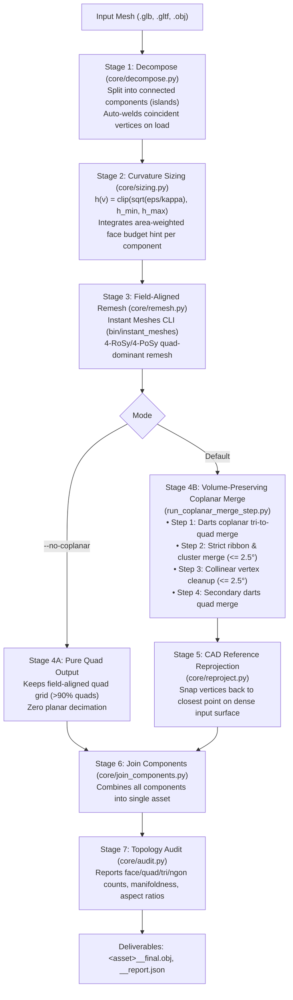

# Pipeline Architecture & Technical Specification

Stage-by-stage technical specification of the pure-Python, zero-Blender retopology pipeline, matching the codebase on branch `im-coplanar-pipeline`.

---

## 1. Pipeline Overview & Flow Architecture

---

## 2. Polygon Categorization & QA Wireframe Rendering

`core/render_honest_wireframe.py` renders polygons directly from native OBJ face loops without triangulating quads or n-gons:

| Color | Polygon Type | Vertex Count | Role in Topology |
| :--- | :--- | :---: | :--- |
| **Blue** | Quad | 4 vertices | Curved contours, cylindrical limbs, bevel transitions, cross-field grid flow. |
| **Yellow** | N-gon | $> 4$ vertices | Planar panels, flat shields, structural walls (in Coplanar mode). |
| **Red** | Triangle | 3 vertices | Pole singularities and boundary seam transitions; minimized across the asset. |

---

## 3. Mathematical & Algorithmic Breakdown

### Stage 1: Component Decomposition (`core/decompose.py`)
- Disjoint set union-find across face adjacency groups loose topological components.
- **Weld-on-load**: Raw inputs (especially OBJ triangle soups with duplicate vertices) are processed via `trimesh.load(..., process=True)` to prevent unshared triangle explosions.

### Stage 2: Curvature-Adaptive Sizing (`core/sizing.py`)
$$h(v) = \text{clip}\left(\sqrt{\frac{\epsilon}{\max(\kappa(v), \kappa_{\text{floor}})}},\; h_{\min},\; h_{\max}\right)$$
$$\text{target\_faces} = \sum_{i} \frac{A_i}{h(v_i)^2}$$
- Integrating by **per-vertex Voronoi area** ($A_i$) prevents large flat surfaces from drowning out the face budget required by thin, high-curvature details (e.g. antennae, fingers, rails).

### Stage 3: Field-Aligned Remeshing (`core/remesh.py`)
- Drives native ARM64/x86_64 `bin/instant_meshes` with parameters:
  - `-D` (dominant quad extraction)
  - `-S 1` (smoothing iterations with ray tracing reprojection)
  - `-c 18.0` (crease angle threshold)
  - `-r 4 -p 4` (4-RoSy orientation symmetry, 4-PoSy position symmetry)
  - `-d` (deterministic algorithm)
  - `-b` (boundary alignment)
- Evaluates output island count via `count_islands` to detect remesher shrapnel failures and triggers automatic fallback if necessary.

### Stage 4: Volume-Preserving Coplanar Consolidation (`run_coplanar_merge_step.py`)
1. **Initial Darts Pass**: Merges adjacent coplanar triangles sharing an edge into single quads (`darts.py`).
2. **Strict Planar Consolidation**:
   - Gated at a strict dihedral threshold: $\theta_{\text{dihedral}} \le 2.5^\circ$.
   - Eliminates chord cutting on curved surfaces ($4^\circ - 9^\circ$ facets).
   - Ribbon line dissolution removes transverse chords across flat quad strips.
   - Disk-topology flood fill collapses clean flat regions into planar n-gons.
   - Non-disk pairwise merging simplifies regions with interior holes or boundary cutouts without ear-clipping slashes.
3. **Collinear Vertex Dissolution**: Removes redundant valence-2 vertices along straight polygon edges ($\le 2.5^\circ$).
4. **Secondary Darts Pass**: Recovers any residual triangle pairs into quads.

### Stage 5: CAD Reference Reprojection (`core/reproject.py`)
- After polygon dissolution, every vertex $v_{\text{new}}$ is mapped back onto the reference surface:
  $$v_{\text{reprojected}} = \arg\min_{p \in \mathcal{M}_{\text{ref}}} \|v_{\text{new}} - p\|_2$$
- Executed via `scipy.spatial.cKDTree` nearest-point projection against the high-density original component mesh.
- Restores exact surface profiles, guaranteeing $\ge 99.5\%$ volume preservation.

### Stage 6: Component Assembly (`core/join_components.py`)
- Aggregates all processed component meshes into a single OBJ while preserving native quad/n-gon definitions and maintaining disconnected component island boundaries.

### Stage 7: Topology & Manifoldness Audit (`core/audit.py`)
- Computes comprehensive quality metrics:
  - Total faces, quad percentage, triangle percentage, n-gon percentage.
  - Non-manifold edge count (must be 0 on closed manifold inputs).
  - Open boundary edges.
  - Quad aspect ratio distribution (under 2.0, 2 to 5, 5 to 20).
  - Edge parallelism metrics.
