# Pipeline Architecture & Flow Specification

Stage-by-stage technical specification of the pure-Python, zero-Blender retopology
pipeline, matching the code in `core/` on this commit.

---

## 1. Pipeline Overview & Flow Diagram

```mermaid
flowchart TD
    Input["Input Mesh (.glb, .gltf, .obj)"] --> Decompose["Stage 1: Decompose (decompose.py)<br/>Split into connected components"]
    Decompose --> Sizing["Stage 2: Curvature Sizing (sizing.py)<br/>h(v) = clip(sqrt(eps/kappa), h_min, h_max)<br/>Integrates a target_faces hint per component"]
    Sizing --> Remesh["Stage 3: Field-Aligned Remesh (remesh.py)<br/>Instant Meshes CLI (bin/instant_meshes)<br/>4-RoSy/4-PoSy quad-dominant remesh"]
    Remesh --> Dissolve["Stage 4: Dissolve (dissolve.py)<br/>Strict full-line pairwise quad decimation<br/>preserves 100% quads and edge flow"]
    Dissolve --> Darts1["Stage 5: Darts Merge (darts.py)<br/>Collapses coplanar tri+tri pairs into quads"]
    Darts1 --> Coplanar["Stage 6: Coplanar Merge (coplanar_merge.py)<br/>Ribbon-line decimation + disk flood-fill merge<br/>+ pairwise non-disk merge around holes/knobs"]
    Coplanar --> Collinear["Stage 7: Collinear Cleanup (editmesh.py)<br/>Dissolves valence-2 vertices on straight boundaries"]
    Collinear --> Caps["Stage 8: Boundary Caps (caps.py)<br/>Caps open planar boundary loops"]
    Caps --> Darts2["Stage 9: Secondary Darts Merge (darts.py)<br/>Catches residual tri pairs created by capping"]
    Darts2 --> Winding["Stage 10: Fix Winding (fix_winding.py)<br/>BFS normal-consistency repair, no triangulation"]
    Winding --> Reproject["Stage 11: Reproject (reproject.py)<br/>cKDTree snap back onto the dense input surface"]
    Reproject --> Join["Stage 12: Join Components (join_components.py)<br/>Merges all finalized components into one asset"]
    Join --> Audit["Stage 13: Audit (audit.py)<br/>Topology metrics: face/quad/tri/ngon counts, manifoldness"]
    Audit --> Deliverables["Deliverables: <base_name>__final.obj, __report.json<br/>written directly into <output_directory>/"]
```



`core/finalize_component.py` runs stages 4–10 as one in-process pass per component
(one `EditMesh`, fault-isolated per stage — a failure in any one stage falls back to the
pre-stage mesh rather than dropping the component). `core/pipeline.py` drives stages 1–3
and 11–13 around it.

---

## 2. Why Outputs Render "Yellow" / "Blue" / "Red"

`core/render_honest_wireframe.py` renders polygons directly from the OBJ face lines
without forcing triangulation:

| Color | Face Type | Arity | Typical Role |
| :--- | :--- | :--- | :--- |
| Yellow | N-gon | > 4 verts | Large flat planar panels (drawer fronts, side panels, flat shells). |
| Blue | Quad | 4 verts | Curved transitions, bevels, cylindrical legs/rails. |
| Red | Triangle | 3 verts | Pole transitions and cap seams; kept to a small fraction of total faces. |

---

## 3. Detailed Stage Breakdown

### Stage 1: Decompose (`core/decompose.py`)
Extracts connected components (`trimesh.graph.connected_components`) and writes each to
its own scratch `.obj`. Detached parts (loose knobs, separate rails) stay separate
components through remeshing.

### Stage 2: Sizing (`core/sizing.py`)
```
h(v)          = clip(sqrt(epsilon / max(kappa(v), floor)), h_min, h_max)
target_faces  = sum_i( vertex_area_i / h_i^2 )     # area-weighted curvature integral
```
Integrating by per-vertex *area* (not a flat mean of `h`) is what keeps small
high-curvature parts (a thin leg) from being swamped by a large low-curvature flat panel
when estimating the face budget — see the inline comment in `sizing.py` for the original
bug this fixed.

### Stage 3: Field-Aligned Remeshing (`core/remesh.py`)
Calls the external `bin/instant_meshes` CLI (batch mode, no GUI) for a field-aligned
quad-dominant remesh honoring `CREASE_DEG` as a hard crease. Falls back to `quadriflow`
or a trimesh quadric decimation if Instant Meshes is unavailable.

### Stage 4: Dissolve (`core/dissolve.py`)
Strict full-line pairwise quad decimation along entire edge loops — merges clean quad
strips without touching curvature-bearing regions. Independently fault-isolated: if this
stage raises, `finalize_component.py` reloads the pre-stage mesh and continues.

### Stage 5 & 9: Darts Merge (`core/darts.py`)
Finds adjacent coplanar triangle pairs (dihedral angle below `COPLANAR_DART_DEG`) sharing
an edge and collapses each pair into one quad.

### Stage 6: Coplanar Region Consolidation (`core/coplanar_merge.py`)
Three-tier consolidation:
1. **Ribbon line decimation** (`merge_ribbon_lines`) — walks regular quad ribbons across
   flat planes, dissolving interior transverse chords.
2. **Disk-topology flood fill** (`find_coplanar_clusters` + `merge_faces`) — groups
   adjacent coplanar faces; if the cluster's boundary is a single simple loop (disk
   topology), collapses it into one clean n-gon.
3. **Non-disk pairwise merge** (`_merge_non_disk_cluster_pairs`) — for regions with
   interior holes/knobs/tufting (non-disk topology), merges adjacent coplanar face pairs
   iteratively instead of collapsing the whole cluster, which would otherwise require
   ear-clipping and produce diagonal slashes through the interior.

### Stage 7: Collinear Boundary Cleanup (`core/editmesh.py`)
Dissolves valence-2 boundary vertices whose two incident edges are collinear within
`PLANAR_STRAIGHTEN_DEG`, leaving a single straight boundary edge.

### Stage 8: Boundary Loop Capping (`core/caps.py`)
Detects open planar boundary loops left by remeshing and builds n-gon/quad caps.

### Stage 10: Normal / Winding Consistency (`core/fix_winding.py`)
BFS traversal across edge adjacency enforcing consistent polygon winding, without
re-triangulating quads or n-gons — needed because `caps.py`'s new faces aren't guaranteed
to match the surrounding mesh's winding.

### Stage 11: Reprojection (`core/reproject.py`)
Snaps simplified vertices back onto the dense original surface via
`scipy.spatial.cKDTree` nearest-point projection, guarding against simplification drift.

### Stage 12: Join (`core/join_components.py`)
Merges all per-component finalized OBJs into one asset.

### Stage 13: Audit (`core/audit.py`)
Computes the topology metrics written to `<base_name>__report.json`: face/quad/tri/ngon
counts and percentages, boundary and non-manifold edge counts, valence-4 percentage, and
face aspect-ratio distribution.

---

## 4. Configuration Parameter Reference (`core/config.py`)

| Parameter | Default | Units | Role |
| :--- | :--- | :--- | :--- |
| `CREASE_DEG` | `18.0` | degrees | Dihedral angle above which Instant Meshes always treats an edge as a hard crease. |
| `TIER1_FLAT_DEG` | `3.0` | degrees | Below this, a face pair is "ultra-flat". |
| `MICRO_FEATURE_CURVE_DEG` | `12.0` | degrees | Curvature angle threshold for the micro-feature protection rule. |
| `MICRO_FEATURE_AREA_FRAC` | `0.15` | fraction | Fraction of local (per-component) median face area treated as a small feature. |
| `DOME_SADDLE_DEG` | `28.0` | degrees | Mean face-normal deviation threshold for pole/dome vertices. |
| `COPLANAR_DART_DEG` | `24.0` | degrees | Triangle-pair coplanarity threshold for dart merging into quads. |
| `PLANAR_STRAIGHTEN_DEG` | `3.0` | degrees | Lattice-straightening / collinear-boundary coplanarity gate. |

All distance/length tolerances used downstream (e.g. in `sizing.py` and
`coplanar_merge.py`) are derived from each mesh's own bounding-box diagonal at the call
site — nothing here is a hardcoded absolute unit, so the pipeline is scale-independent.

---

## 5. Module Inventory (`core/`)

| Module | Role |
| :--- | :--- |
| `pipeline.py` | End-to-end pipeline coordinator (stages 1–3, 11–13). |
| `config.py` | Binary paths and all tunables. |
| `decompose.py` | Connected-component decomposition. |
| `sizing.py` | Curvature-adaptive face-target estimation. |
| `remesh.py` | Instant Meshes / quadriflow wrapper. |
| `finalize_component.py` | Per-component stages 4–10, one `EditMesh` pass. |
| `dissolve.py` | Full-line pairwise quad decimation. |
| `darts.py` | Triangle-pair to quad merge. |
| `coplanar_merge.py` | Coplanar clustering, ribbon decimation, non-disk pairwise merge. |
| `caps.py` | Planar boundary loop capping. |
| `fix_winding.py` | BFS winding-consistency repair. |
| `reproject.py` | cKDTree surface snapping. |
| `editmesh.py` | Pure-Python mutable polygon mesh (BMesh-style adjacency). |
| `obj_io.py` | Native polygon OBJ parser/writer (preserves quad/n-gon arity). |
| `io_mesh.py` | Unified GLB/GLTF/OBJ load/export. |
| `join_components.py` | Component merger. |
| `audit.py` | Topology metrics. |
| `curvature.py` | Per-vertex curvature field (via `igl`). |
| `render_honest_wireframe.py` | QA wireframe renderer (yellow/blue/red by face arity). |
| `protect.py`, `render_protect_debug.py` | Curvature edge-cost field and its debug viewer; not wired into `run_pipeline.py`, kept for standalone experimentation. |
